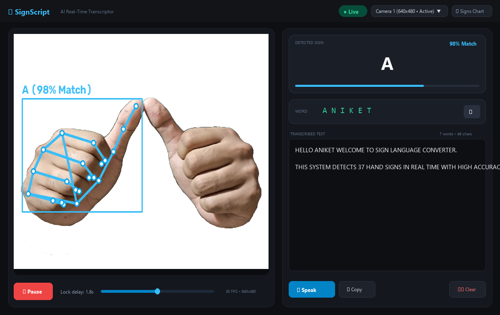
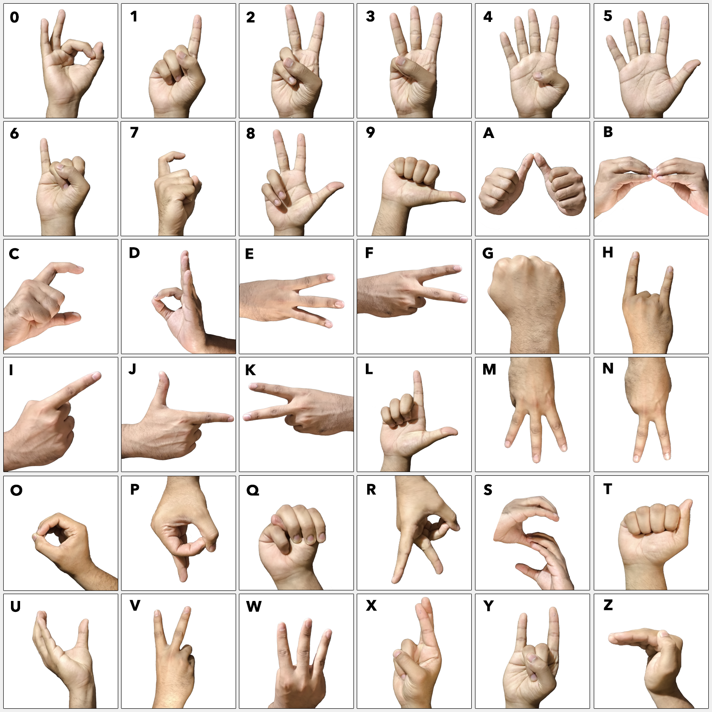

# AI Sign Language Detector & Transcriptor 🤟💬

[](https://www.python.org/)
[](https://developers.google.com/mediapipe)
[](https://scikit-learn.org/)
[](https://customtkinter.tomschimansky.com/)

A real-time, **100% native desktop application** that converts **Sign Language Gestures (Indian / American Sign Language)** into **Text** and **Spoken Audio**.

---

## 📸 Application Screenshots

### Desktop GUI Dashboard


### Sign Language Reference Chart (37 Gestures)


---

## ✨ Features

- **100% Native Desktop Experience**: Built with CustomTkinter for a fast, responsive, and modern dark-mode interface. Zero browser dependencies, no local web server required.
- **Real-Time Hand Landmark Tracking**: Powered by MediaPipe 21-point hand tracking with high FPS and sub-pixel accuracy.
- **Smart Camera Auto-Detection**: Automatically identifies active hardware webcam devices (`Camera 1` / `Camera 2`) and provides seamless runtime camera switching.
- **99.93% Classification Accuracy**: Trained across 37 classes (A–Z letters, 0–9 digits, and Next/Space sign) with 7,387 samples.
- **Intelligent Word Formation & Spell Checking**: Uses PyEnchant English dictionary with custom vocabulary to auto-correct typos on every 'Next' gesture.
- **Audio Output (Text-To-Speech)**: Integrated offline `pyttsx3` speech engine reads out formed words and sentences aloud in a dedicated thread.
- **Clipboard & File Export**: One-click copy to Windows clipboard or save to output text files.

---

## 🚀 Quick Start

### 1. Installation
Ensure Python 3.10+ is installed, then install dependencies:
```bash
pip install -r requirements.txt
```

### 2. Launch the Application
Double-click **`start.bat`** or run:
```bash
python run.py
```

---

## 📁 Project Structure

```
Sign-language-conversion-main/
├── Model/
│   ├── data_final.pickle           # 7,387 sample landmark dataset
│   ├── model_final.p               # Trained Random Forest classifier (99.93% accuracy)
│   └── hand_landmarker.task        # MediaPipe Vision Landmarker task model
├── Source code/
│   ├── Final_detector.py           # Clean Modern Desktop GUI application
│   ├── train_classifier.py         # Model training pipeline
│   ├── create_dataset.py           # Feature extraction & dataset builder
│   └── collect_imgs.py             # Image dataset collection tool
├── images/
│   ├── symbol.png                  # Master reference chart
│   ├── symbol images/              # Individual sign reference photos
│   └── screenshots/                # Application preview screenshots
├── run.py                          # Unified desktop launcher
├── start.bat                       # One-click Windows runner
└── requirements.txt                # Python dependencies
```

---

## 🎯 How It Works

1. **Sign Detection**: The camera captures your hand and MediaPipe extracts 21 landmark coordinate pairs `(x, y)`.
2. **Feature Engineering**: Coordinates are normalized by subtracting bounding minimums, and squared terms are computed to yield an 84-dimensional feature vector.
3. **Classification**: The Random Forest model predicts the letter/digit with high confidence.
4. **Hold Confirmation**: Holding a sign steady for the configured duration (default: 1.8s) appends the character to the active word.
5. **Word & Sentence Building**: Making the **'Next'** sign runs English spell-checking via PyEnchant, corrects typos, appends the word to the sentence, and resets the word buffer.
6. **Speech Synthesis**: Clicking **Speak** reads the generated sentence aloud!

---

## 📜 License
Open source project created by **Aniket Sharma**.
